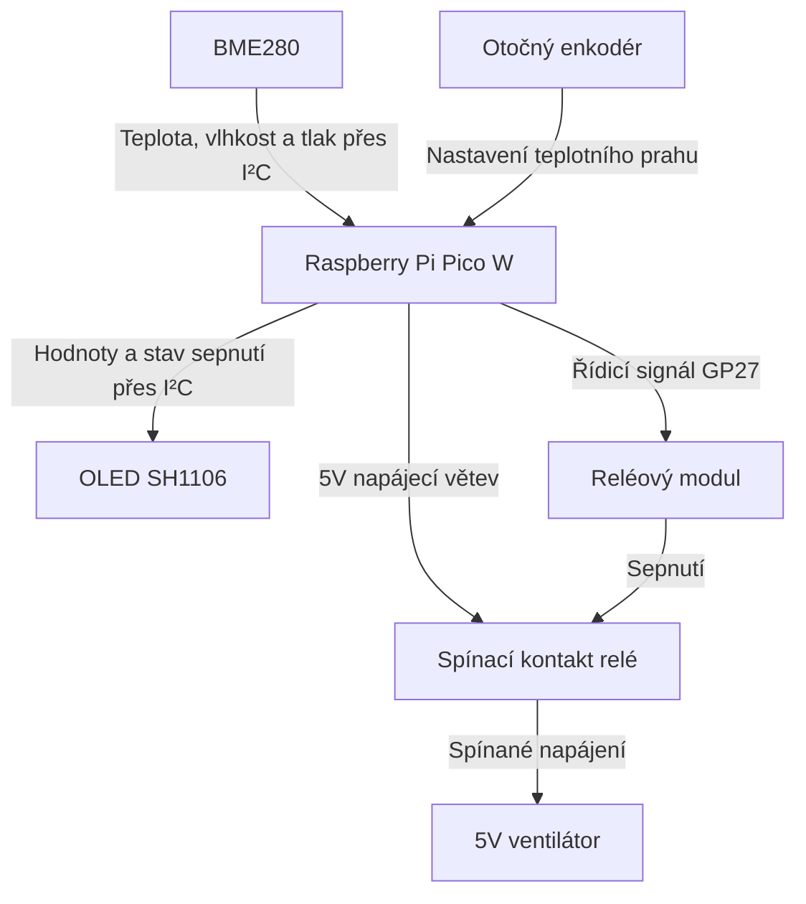

# Chytrý skleník

Týmový projekt pro Raspberry Pi Pico W a MicroPython. Zařízení měří teplotu, relativní vlhkost a atmosférický tlak pomocí BME280. Naměřené hodnoty zobrazuje na OLED a podle teploty automaticky spíná 5V ventilátor přes reléový modul.

## Tým

| Členové týmu |
| --- |
| Pavel Hroch |
| Jerguš Gecík |
| Matouš Huczala |

## Obsluha a řízení ventilátoru

Při zachycení sestupné hrany signálu `CLK` z enkodéru program změní teplotní práh o 0,5 °C. Práh se zvýší, když je `DT` v logické 1, a sníží, když je `DT` v logické 0. Stisk tlačítka enkodéru vrátí práh na výchozích 25,3 °C.

OLED zobrazuje naměřené hodnoty, aktuální práh a stav sepnutí. Při změně prahu ukáže `THRESHOLD SET` a při resetu `RESET`. K zobrazení `ON` nebo `OFF` se vrací při dalším měření.

Ventilátor se zapíná při dosažení nastaveného prahu a vypíná při poklesu o 0,5 °C pod něj. Při výchozím prahu 25,3 °C platí následující hodnoty.

| Naměřená teplota | Stav ventilátoru |
| --- | --- |
| 25,3 °C a více | Zapnutý |
| Mezi 24,8 °C a 25,3 °C | Zachová předchozí stav |
| 24,8 °C a méně | Vypnutý |

Hystereze omezuje opakované spínání relé při malých změnách teploty kolem prahu.

## Hardware a zapojení

| Část | Nastavení nebo připojení |
| --- | --- |
| Raspberry Pi Pico W | MicroPython |
| Sběrnice I²C0 | SDA na GP4, SCL na GP5, 100 kHz |
| BME280 | I²C0, očekávaná adresa `0x76` |
| OLED s řadičem SH1106 | I²C0, očekávaná adresa `0x3C` |
| Otočný enkodér | CLK na GP10, DT na GP11, SW na GP12 |
| Reléový modul | Řídicí signál na GP27, program při požadavku na sepnutí nastaví logickou 1 |
| 5V ventilátor | Napájení z 5V vývodu Pico W přes kontakt reléového modulu |

### Časování

| Činnost | Kdy probíhá |
| --- | --- |
| Čtení BME280 | Při startu, potom přibližně každých 5 s |
| Obsluha enkodéru | Průběžně, i mezi měřeními |
| Vyhodnocení stavu relé | V každém průchodu smyčkou podle poslední změřené teploty a aktuálního prahu |
| Aktualizace OLED | Při startu, novém měření, otočení enkodéru nebo resetu prahu |

## Architektura

