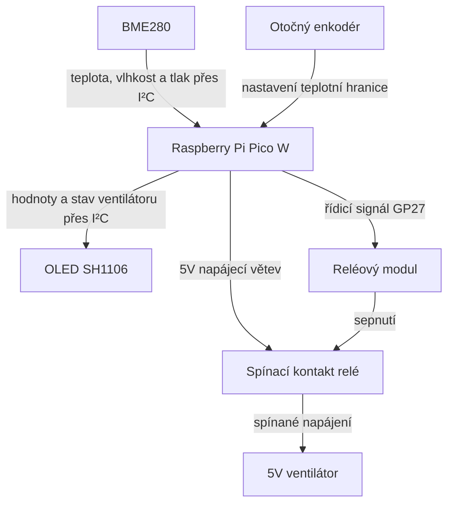

# Chytrý skleník

Týmový projekt pro Raspberry Pi Pico W a MicroPython. Zařízení má zobrazovat teplotu a vlhkost ve skleníku a automaticky spínat 5V ventilátor přes reléový modul. Teplotní hranici pro sepnutí nastaví uživatel otočným enkodérem.

## Tým

| Členové týmu |
| --- |
| Pavel Hroch | 
| Jerguš Gecík | 
| Matouš Huczala | 

## Stav po prvním týdnu

V `main.py` je první verze programu. Kód každé dvě sekundy čte teplotu, vlhkost a tlak z BME280, vypisuje údaje do konzole a zobrazuje je na OLED. Při teplotě alespoň 25,3 °C nastaví výstup GP27 na logickou 1, při nižší teplotě na 0.

Teplotní hranice je pevně zadaná v kódu. OLED zatím zobrazuje text `ON` bez ohledu na hodnotu výstupu. Nastavení hranice otočným enkodérem a zobrazení stavu ventilátoru přibudou při integraci.

## Hardware a plán zapojení

| Část | Nastavení nebo připojení |
| --- | --- |
| Raspberry Pi Pico W | MicroPython |
| BME280 | I²C0, ověřovaná adresa `0x76` |
| OLED s řadičem SH1106 | Stejná I²C sběrnice jako BME280, adresu ověříme |
| Sběrnice I²C0 | SDA na GP4, SCL na GP5, 100 kHz |
| Reléový modul | Řídicí signál na GP27 |
| 5V ventilátor | Napájení z 5V vývodu Pico W přes kontakt reléového modulu |
| Otočný enkodér | Plánované nastavení teplotní hranice |

## Návrh architektury

Pico W porovnává naměřenou teplotu s hranicí nastavenou enkodérem. Řídicí signál GP27 ovládá reléový modul. Jeho kontakt spíná napájecí větev ventilátoru. OLED má zobrazovat naměřené hodnoty, nastavenou hranici a stav spínání.

### Plán časování

| Činnost | Kdy probíhá |
| --- | --- |
| Čtení BME280 | Přibližně každých 5 s |
| Obsluha enkodéru | Průběžně, i mezi měřeními |
| Vyhodnocení spínání relé | Po novém měření nebo po změně teplotní hranice |
| Aktualizace OLED | Při změně zobrazených hodnot, hranice nebo stavu spínání |