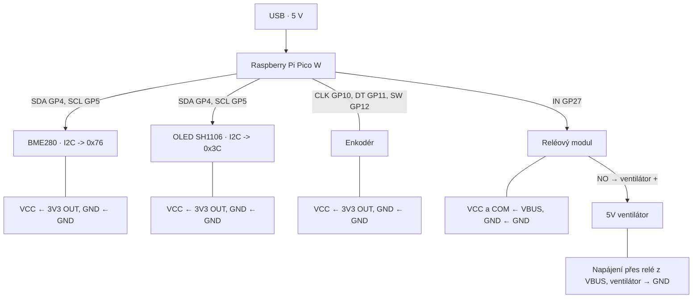

# Chytrý skleník

Týmový projekt předmětu DE2 pro Raspberry Pi Pico W a MicroPython. BME280 měří teplotu, relativní vlhkost a atmosférický tlak. OLED slouží k zobrazení naměřených hodnot, stavu řízení ventilátoru a teplotního prahu. Nízkonapěťový ventilátor se spíná přes reléový modul podle teploty a hystereze. Práh se nastavuje otočným enkodérem.

## Tým

| Člen týmu | Role a zpracované části |
| --- | --- |
| Pavel Hroch | |
| Jerguš Gecík | |
| Matouš Huczala | |

### Aktuální postup 

| Komponenta | Stav |
| --- | --- |
| BME280 | čtení teploty a vlhkosti ověřeno na hardware |
| OLED | zobrazení textu a hodnot ověřeno na hardware |
| Enkodér | funkčnost ověřena na hardware |
| Relé a spínání ventilátoru | funkčnost ověřena na hardware |
| Režim SET | upraven - čeká na ověření |

### Struktura repozitáře

| Úroveň | Soubor nebo adresář | Obsah |
| --- | --- | --- |
| 0 | `smart-greenhouse-project/` | Kořen projektu |
| 1 | `main.py` | Inicializace, čtení senzorů, OLED, enkodér a řízení relé |
| 1 | `README.md` | Popis projektu, zapojení |

## Funkce projektu

- Čtení BME280 při startu a potom přibližně každých 5 sekund.
- Výpis naměřených hodnot, prahu a stavu ventilátoru na OLED.
- Nastavování teplotního prahu enkodérem v režimu SET -> funkčnost bude testována na aktuálním cvičení.  
- Řízení ventilátoru s hysterezí 0,5 °C.
- Výpis hodnot a změn prahu do konzole.
- Vypnutí relé a vymazání OLED při ukončení pomocí `Ctrl+C` v hlavní smyčce.

### Software a použité knihovny

| Modul | Použité rozhraní | Dostupnost a verze |
| --- | --- | --- |
| `machine` | `I2C`, `Pin` | Součást MicroPython |
| `micropython` | `const()` | Součást MicroPython |
| `time` | `ticks_ms()`, `ticks_diff()`, `sleep_ms()` | Součást MicroPython |
| `bme280` | `BME280(i2c)`, `read_values()` | bme280.py |
| `sh1106` | `SH1106_I2C(i2c)`, `fill()`, `text()`, `show()` | sh1106.py | 

### Časování

| Činnost | Kdy probíhá |
| --- | --- |
| Čtení BME280 | Při startu, potom přibližně každých 5 s |
| Obsluha enkodéru | Průběžně, i mezi měřeními |
| Vyhodnocení stavu relé | V každém průchodu smyčkou podle poslední změřené teploty a aktuálního prahu |
| Aktualizace OLED | Při startu, novém měření, otočení enkodéru nebo resetu prahu |

### Aktuální obsluha a řízení ventilátoru

Výchozí práh je 25 °C. Otočení enkodéru otevře SET, kde každá zachycená změna `CLK` upraví práh o 0,5 °C podle směru otáčení. Hodnota se vypisuje do konzole. Stisk `SW` ukončí nastavování. Po dobu SET se měření a řízení relé pozastaví. -> Bude testováno v aktuálním cvičení. 

Ventilátor se zapne při dosažení prahu a vypne při poklesu o 0,5 °C pod něj. Mezi těmito hodnotami zachová stav. Pro výchozí práh tedy zapíná při 25 °C a vypíná při 24,5 °C. OLED při pravidelném měření zobrazuje `FAN ON` nebo `FAN OFF`.

| Naměřená teplota | Stav ventilátoru |
| --- | --- |
| 25 °C a více | Zapnutý |
| Mezi 24,5 °C a 25 °C | Zachová předchozí stav |
| 24,5 °C a méně | Vypnutý |

Hystereze omezuje opakované spínání relé při malých změnách teploty kolem prahu.

### Použité piny a napájení komponent

### Datasheety použitých komponent
https://dratek.cz/docs/produkty/0/91/1469214547.pdf?_gl=1*nyfb3b*_up*MQ..*_gs*MQ..&gclid=CjwKCAiAq5rYBhB-EiwAhj1RdoQkxj2hzgVd5F5-xXEWCIOLdYoFOWIm_yEK7z2nehLjYpPXo5ZPFBoCGHEQAvD_BwE&gbraid=0AAAAACVG_Wd15X70Z68DzIOKZ2zymInWN
https://dratek.cz/docs/produkty/1/1659/1500635991.pdf?_gl=1*9oh2xi*_up*MQ..*_gs*MQ..&gclid=CjwKCAiAq5rYBhB-EiwAhj1Rdqtv5iCG2Vo1G0R5iAwgykYOz8C4M5KL1Mt_63m5CYRQc9xTx7Q_7RoCf00QAvD_BwE&gbraid=0AAAAACVG_Wd15X70Z68DzIOKZ2zymInWN
https://dratek.cz/docs/produkty/1/1551/1527497643.pdf?_gl=1*1vzanny*_up*MQ..*_gs*MQ..&gclid=CjwKCAiAq5rYBhB-EiwAhj1RdszrcM0BT8ajuVFm3U9bU3Ko4qbty54q9jzbfMM2_Z8wNNa1jcZmghoC3r0QAvD_BwE&gbraid=0AAAAACVG_WfRWlHZXofnJ3-tDcn3BGKvy
